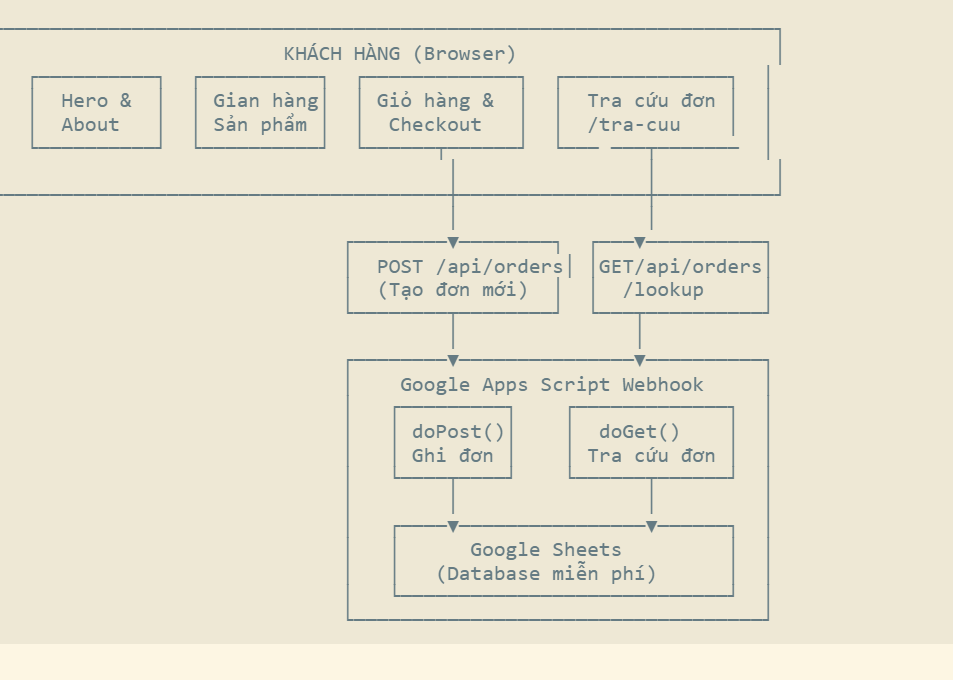
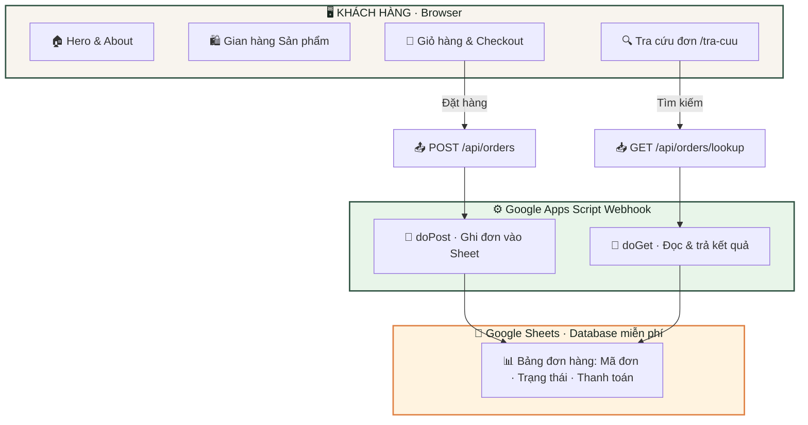

<div align="center">

# 🌾 Dòng Nước Về Nguồn

### *Góp nắng gửi yêu thương, tri ân ngàn người lính*

[](https://dongnuocvenguon.vercel.app)
[](https://nextjs.org/)
[](https://www.typescriptlang.org/)
[](https://tailwindcss.com/)
[](https://dongnuocvenguon.vercel.app)

<br/>

**Nền tảng e-commerce thiện nguyện** được xây dựng bởi nhóm sinh viên **The Boys Project** — Đại học FPT TP.HCM.
Toàn bộ doanh thu sẽ được quy đổi thành **20 phần quà tri ân** gửi tặng các anh hùng thương binh nhiễm chất độc da cam.

<br/>

</div>

## 📋 Mục Lục

- [Tổng Quan Dự Án](#-tổng-quan-dự-án)
- [Kiến Trúc Hệ Thống](#-kiến-trúc-hệ-thống)
- [Tính Năng Nổi Bật](#-tính-năng-nổi-bật)
- [Công Nghệ Sử Dụng](#-công-nghệ-sử-dụng)
- [Cấu Trúc Dự Án](#-cấu-trúc-dự-án)
- [Hướng Dẫn Cài Đặt](#-hướng-dẫn-cài-đặt)
- [Triển Khai (Deployment)](#-triển-khai-deployment)
- [Tác Giả](#-tác-giả)

---

## 🎯 Tổng Quan Dự Án

| Thông tin                     | Chi tiết                                                               |
| ------------------------------ | ----------------------------------------------------------------------- |
| **Tên chiến dịch**    | Hành Trình Dòng Nước Về Nguồn                                    |
| **Nhóm thực hiện**    | The Boys Project — Sinh viên ĐH FPT TP.HCM                           |
| **Mục tiêu gây quỹ** | 3.000.000đ → 20 phần quà tri ân thương binh                      |
| **Ngày mở bán**       | 13/10/2026                                                              |
| **Ngày Workshop**       | 17/10/2026                                                              |
| **Website**              | [dongnuocvenguon.vercel.app](https://dongnuocvenguon.vercel.app) |
| **Liên hệ hỗ trợ**   | Zalo:[0916 532 006](https://zalo.me/0916532006)                          |

### 💝 Mỗi Phần Quà Tri Ân Bao Gồm

> Dành tặng các cô chú thương binh nhiễm chất độc da cam — những người có chỉ số thương tật nặng, không còn người thân chăm sóc.

| Quà tặng                                          | Giá trị    |
| --------------------------------------------------- | ------------ |
| 🥛 Hộp sữa Ensure Gold pha sẵn                   | 68.000đ     |
| 🍰 Hộp bánh bông lan Solite (18 cái)            | 53.000đ     |
| 🥛 Lốc sữa dinh dưỡng Nutifood ít đường     | 36.000đ     |
| 💌 Thư tri ân viết tay từ tấm lòng sinh viên | *Vô giá* |

---

## 🏗 Kiến Trúc Hệ Thống



---

## ✨ Tính Năng Nổi Bật

### 🎨 Giao Diện & Trải Nghiệm

- **Responsive Design** — Hoàn hảo trên mọi thiết bị từ mobile đến desktop
- **Dark / Light Mode** — Tự phát hiện system preference, lưu qua localStorage
- **Design System riêng** — Bảng màu ấm áp, mộc mạc với CSS Custom Properties:
  - Xanh rừng `#315444` · Cam nắng `#df8143` · Vàng ấm `#e6b057`
- **Typography** — Be Vietnam Pro + Lora (Google Fonts) cho tiếng Việt hoàn hảo
- **Micro-animations** — Glassmorphism, hover effects, smooth transitions

### 🛒 Gian Hàng Thương Mại Điện Tử

| Danh mục               | Sản phẩm                                                                      | Giá        |
| ----------------------- | ------------------------------------------------------------------------------- | ----------- |
| 🥖 Đồ ăn vặt        | Bánh tráng ngũ vị, Thạch Yogurt Jelly                                      | 10K – 25K  |
| ☕ Đồ uống           | Cafe đen BERYL, Cafe sữa, Trà tắc                                           | 10K – 15K  |
| 🌹 Hoa tươi 20/10     | Hoa hồng, Hoa đồng tiền (1–5 bông)                                        | 30K – 144K |
| 🎁 Combo Workshop 17/10 | Gửi lời, Một bông yêu thương, Tự tay yêu thương, Tự tay hạnh phúc | 59K – 204K |

### 🛍 Slide-over Cart Drawer

- Thêm / xóa / chỉnh số lượng sản phẩm với cập nhật tổng tiền realtime
- Tuỳ chọn biến thể hoa (hồng / đồng tiền) với giá tự động cập nhật
- Form đặt hàng đầy đủ: Họ tên, Email, SĐT, Địa chỉ, Ngày nhận, Khung giờ, Địa điểm
- Thanh toán **Chuyển khoản VietQR** — tự động generate mã QR với số tiền chính xác
- Toast notification thay vì auto-open cart — trải nghiệm mượt hơn

### 🔍 Tra Cứu Đơn Hàng (`/tra-cuu`)

- Tra theo **Mã đơn (DHxxxx)** hoặc **Số điện thoại** — real-time từ Google Sheet
- Hiển thị trạng thái đơn với color-coded indicators (Thành công / Chờ xử lý / Huỷ)
- Thông báo đặc biệt cho đơn chờ thanh toán: "Vui lòng chờ 15–20 phút để đối soát"
- **Cache-busting** — mỗi lần tra cứu luôn lấy dữ liệu mới nhất, không bao giờ cache cũ

### 💬 Hỗ Trợ Khách Hàng

- **Nút Zalo nổi (Floating Button)** — góc dưới bên trái mọi trang, hiệu ứng pulse thu hút
- Click mở trực tiếp chat Zalo: **0916 532 006**

---

## 🛠 Công Nghệ Sử Dụng

| Layer                | Công nghệ                              | Vai trò                                     |
| -------------------- | ---------------------------------------- | -------------------------------------------- |
| **Framework**  | Next.js 14 (App Router)                  | SSR/SSG, API Routes, File-based routing      |
| **Language**   | TypeScript 5.6                           | Type safety, IntelliSense, code quality      |
| **Styling**    | Tailwind CSS 3.4 + CSS Custom Properties | Design system, responsive, dark mode         |
| **Typography** | Google Fonts (Be Vietnam Pro, Lora)      | Hiển thị tiếng Việt hoàn hảo           |
| **Icons**      | Lucide React                             | Bộ icon nhẹ, tree-shakable                 |
| **State**      | React Context + useState                 | Cart management, theme toggling              |
| **Backend**    | Next.js API Routes → Google Apps Script | Serverless proxy, zero infrastructure cost   |
| **Database**   | Google Sheets                            | Free, real-time, team-accessible spreadsheet |
| **Payment**    | VietQR API                               | Tạo mã QR chuyển khoản tự động        |
| **Hosting**    | Vercel                                   | Auto-deploy từ GitHub, global CDN           |

---

## 📁 Cấu Trúc Dự Án

```
TheBoys/
├── public/
│   └── images/              # Ảnh sản phẩm (hoa, đồ ăn, combo)
├── scripts/
│   └── google-apps-script.js # Code Google Apps Script (doPost + doGet)
├── src/
│   ├── app/
│   │   ├── layout.tsx        # Root layout (fonts, theme, ZaloButton)
│   │   ├── page.tsx          # Trang chủ
│   │   ├── globals.css       # Design tokens & CSS custom properties
│   │   ├── tra-cuu/          # Trang tra cứu đơn hàng
│   │   └── api/
│   │       └── orders/
│   │           ├── route.ts         # POST — tạo đơn hàng mới
│   │           └── lookup/
│   │               └── route.ts     # GET — tra cứu đơn hàng
│   ├── components/
│   │   ├── Header.tsx        # Navigation + Dark mode toggle
│   │   ├── Hero.tsx          # Hero banner chiến dịch
│   │   ├── AboutSection.tsx  # Giới thiệu & mục tiêu gây quỹ
│   │   ├── ShopSection.tsx   # Gian hàng sản phẩm
│   │   ├── ProductCard.tsx   # Card sản phẩm (badge, biến thể, ảnh)
│   │   ├── CartDrawer.tsx    # Giỏ hàng slide-over + checkout form
│   │   ├── OrderLookup.tsx   # UI tra cứu đơn hàng
│   │   ├── VoucherBanner.tsx # Banner ưu đãi (reserved)
│   │   ├── ZaloButton.tsx    # Nút Zalo nổi (floating FAB)
│   │   └── Footer.tsx        # Footer
│   ├── context/
│   │   └── CartContext.tsx    # Global cart state + toast notifications
│   ├── data/
│   │   └── campaign.ts       # Dữ liệu sản phẩm, giá, combo, banking
│   └── types/
│       └── index.ts          # TypeScript interfaces
├── .env.local                # GOOGLE_SHEET_WEBHOOK_URL (secret)
├── tailwind.config.ts
├── tsconfig.json
└── package.json
```

---

## 🚀 Hướng Dẫn Cài Đặt

### Yêu Cầu

- **Node.js** ≥ 18
- **npm** ≥ 9
- Tài khoản Google (để kết nối Google Sheets)

### 1. Clone & Cài đặt

```bash
git clone https://github.com/Nguyen-Van-Gia-Binh/The-Boys.git
cd The-Boys
npm install
```

### 2. Cấu hình môi trường

```bash
cp .env.example .env.local
```

Mở `.env.local` và cập nhật:

```env
GOOGLE_SHEET_WEBHOOK_URL="https://script.google.com/macros/s/YOUR_SCRIPT_ID/exec"
```

### 3. Thiết lập Google Sheets

1. Tạo Google Sheet mới với dòng tiêu đề hàng 1:
   | Mã đơn | Thời gian | Họ tên | SĐT | Email | Ngày nhận | Khung giờ | Địa điểm | Địa chỉ chi tiết | Món đặt | Tạm tính | Giảm giá | Tổng thanh toán | Phương thức | Ghi chú | Trạng thái |
   | --------- | ---------- | -------- | ---- | ----- | ----------- | ---------- | ------------ | -------------------- | ---------- | ---------- | ---------- | ----------------- | -------------- | -------- | ------------ |
2. Vào **Tiện ích mở rộng** → **Apps Script**
3. Paste nội dung từ [`scripts/google-apps-script.js`](scripts/google-apps-script.js)
4. **Deploy** → **New deployment** → **Web app** → Execute as: Me → Access: **Anyone**
5. Copy Web App URL → paste vào `.env.local`

> **⚠️ Lưu ý**: Mỗi khi chỉnh sửa Apps Script, cần vào **Manage deployments** → **Edit** → chọn **New version** → **Deploy** để thay đổi có hiệu lực.

### 4. Chạy Development Server

```bash
npm run dev
```

Truy cập: [http://localhost:3000](http://localhost:3000)

---

## 🌍 Triển Khai (Deployment)

### Vercel (Đang sử dụng)

1. Push code lên GitHub
2. Truy cập [vercel.com](https://vercel.com) → **Add New Project** → chọn repo `The-Boys`
3. Thêm **Environment Variable**: `GOOGLE_SHEET_WEBHOOK_URL`
4. Bấm **Deploy** — sau ~30 giây sẽ có link production

Hoặc deploy qua CLI:

```bash
npx vercel --prod
```

**Production URL**: [`https://dongnuocvenguon.vercel.app`](https://dongnuocvenguon.vercel.app)

---

## 👨‍💻 Tác Giả

<div align="center">

### Nguyễn Văn Gia Bình

**Full-Stack Developer** · Sinh viên Đại học FPT TP.HCM

[](https://github.com/Nguyen-Van-Gia-Binh)
[](mailto:nguyenvangiabinh22072006@gmail.com)

</div>

---

<div align="center">

*Dự án được xây dựng với ❤️ vì cộng đồng*

**The Boys Project** · ĐH FPT TP.HCM · 2026

</div>
