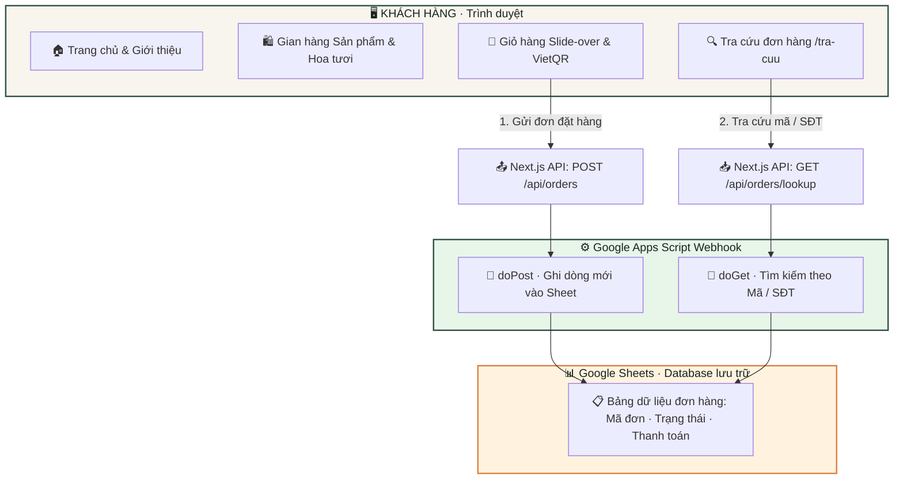

<div align="center">

# 🌾 Dòng Nước Về Nguồn

### *Góp nắng gửi yêu thương, tri ân ngàn người lính*

[](https://dongnuocvenguon.vercel.app)
[](https://nextjs.org/)
[](https://www.typescriptlang.org/)
[](https://tailwindcss.com/)
[](https://dongnuocvenguon.vercel.app)

<br/>

**Nền tảng e-commerce thiện nguyện** được phát triển bởi **The Boys Project** — Sinh viên Đại học FPT TP.HCM.  
Toàn bộ lợi nhuận từ chiến dịch sẽ được quy đổi thành **20 phần quà đặc biệt** gửi tặng tận tay các cô chú thương binh nhiễm chất độc da cam.

<br/>

</div>

---

## 📋 Mục Lục

- [🎯 Tổng Quan Dự Án](#-tổng-quan-dự-án)
- [🏗 Kiến Trúc Hệ Thống](#-kiến-trúc-hệ-thống)
- [✨ Tính Năng Nổi Bật](#-tính-năng-nổi-bật)
- [🛠 Công Nghệ Sử Dụng](#-công-nghệ-sử-dụng)
- [📁 Cấu Trúc Dự Án](#-cấu-trúc-dự-án)
- [🚀 Hướng Dẫn Cài Đặt](#-hướng-dẫn-cài-đặt)
- [🌍 Triển Khai (Deployment)](#-triển-khai-deployment)
- [👨‍💻 Tác Giả](#-tác-giả)

---

## 🎯 Tổng Quan Dự Án

| Thông tin | Chi tiết |
| :--- | :--- |
| **Tên chiến dịch** | Hành Trình Dòng Nước Về Nguồn |
| **Đơn vị thực hiện** | The Boys Project — Sinh viên Đại học FPT TP.HCM |
| **Mục tiêu gây quỹ** | Gây quỹ trao tặng 20 phần quà tri ân thương binh |
| **Ngày mở bán đợt 1** | 13/10/2026 |
| **Sự kiện Workshop** | 17/10/2026 (Nhận hoa tại Sảnh Gương, ĐH FPT) |
| **Website chính thức** | [dongnuocvenguon.vercel.app](https://dongnuocvenguon.vercel.app) |
| **Hotline / Zalo** | [0916 532 006](https://zalo.me/0916532006) |

### 💝 Chi Tiết 20 Phần Quà Tri Ân

> Dành tặng các cô chú thương binh nhiễm chất độc da cam — những người có chỉ số thương tật nặng, không còn người thân chăm sóc.

| Quà tặng | Giá trị ước tính |
| :--- | :--- |
| 🥛 Hộp sữa Ensure Gold pha sẵn | 68.000đ |
| 🍰 Hộp bánh bông lan Solite (18 cái) | 53.000đ |
| 🥛 Lốc sữa dinh dưỡng Nutifood ít đường | 36.000đ |
| 💌 Thư tri ân viết tay từ tấm lòng sinh viên | *Vô giá* |

---

## 🏗 Kiến Trúc Hệ Thống



---

## ✨ Tính Năng Nổi Bật

### 🎨 Giao Diện & Trải Nghiệm (UI/UX)
- **Responsive 100%**: Tối ưu hiển thị mượt mà trên iPhone, Android, Tablet và Desktop.
- **Dark / Light Mode**: Tự động nhận diện theme hệ thống, có nút chuyển đổi tức thì và ghi nhớ qua `localStorage`.
- **Thiết kế theo Brand Identity**: Bảng màu mộc mạc, truyền cảm hứng (Xanh rêu `#315444`, Cam đất `#df8143`, Vàng lúa `#e6b057`).
- **Typography thuần Việt**: Kết hợp font chữ Google Fonts `Be Vietnam Pro` và `Lora` sang trọng, chuẩn dấu tiếng Việt.

### 🛒 Gian Hàng & Giỏ Hàng Thông Minh
- **Đa dạng danh mục**: Ăn vặt, Cafe, Đồ uống giải khát, Hoa tươi 20/10 tự gói, Combo quà tặng 17/10.
- **Tùy biến biến thể**: Cho phép khách chọn số lượng hoa hồng / đồng tiền với tính toán giá tức thì.
- **Slide-over Drawer**: Giỏ hàng trượt mượt mà, hỗ trợ thêm voucher giảm giá và tính toán tổng tiền realtime.
- **Thanh toán VietQR**: Tự động render mã QR chuyển khoản chính xác tới từng đồng, kèm cú pháp nội dung chuyển khoản.

### 🔍 Tra Cứu Đơn Hàng Tức Thì (`/tra-cuu`)
- Tra cứu nhanh theo **Mã đơn hàng** hoặc **Số điện thoại**.
- **Real-time & Cache-busting**: Mỗi lần tìm kiếm luôn gọi trực tiếp Google Sheets và cập nhật trạng thái mới nhất.
- Phân biệt rõ trạng thái đơn hàng (Đã xác nhận, Chờ thanh toán, Đang chuẩn bị, Đã giao).

### 💬 Hỗ Trợ Trực Tuyến Nhanh
- **Floating Zalo Button**: Nút tròn hỗ trợ nổi góc dưới bên trái ở mọi trang, click mở thẳng chat Zalo `0916 532 006`.

---

## 🛠 Công Nghệ Sử Dụng

| Tầng | Công nghệ | Mục đích |
| :--- | :--- | :--- |
| **Framework** | Next.js 14 (App Router) | Server-Side Rendering, API Routes, Tối ưu SEO |
| **Ngôn ngữ** | TypeScript 5.6 | Đảm bảo tính an toàn kiểu dữ liệu và dễ bảo trì |
| **Giao diện** | Tailwind CSS 3.4 + CSS Variables | Hệ thống Design System đồng bộ, Dark mode |
| **Font chữ** | Google Fonts (Be Vietnam Pro, Lora) | Hiển thị tiếng Việt tinh tế |
| **Icons** | Lucide React | Bộ icon hiện đại, hiệu năng cao |
| **Backend & DB** | Next.js API Routes → Google Apps Script | Không tốn chi phí server, kết nối Google Sheets |
| **Lưu trữ** | Google Sheets | Quản lý đơn hàng trực quan, dễ chia sẻ trong team |
| **Thanh toán** | VietQR API | Sinh mã QR ngân hàng tự động |
| **Deploy** | Vercel | Triển khai nhanh, CI/CD tự động |

---

## 📁 Cấu Trúc Dự Án

```
TheBoys/
├── public/
│   └── images/               # Ảnh chụp sản phẩm, hoa tươi, combo
├── scripts/
│   └── google-apps-script.js  # Mã nguồn Google Apps Script (doPost, doGet)
├── src/
│   ├── app/
│   │   ├── layout.tsx         # Root layout (Fonts, Dark mode, Floating Zalo)
│   │   ├── page.tsx           # Trang chủ chiến dịch
│   │   ├── globals.css        # Biến màu Design System và utility styles
│   │   ├── tra-cuu/           # Trang tra cứu đơn hàng (/tra-cuu)
│   │   └── api/
│   │       └── orders/
│   │           ├── route.ts          # POST: Tạo đơn hàng vào Google Sheet
│   │           └── lookup/
│   │               └── route.ts      # GET: Tra cứu đơn hàng thời gian thực
│   ├── components/
│   │   ├── Header.tsx         # Header, Navigation, Dark Mode toggle
│   │   ├── Hero.tsx           # Hero section truyền cảm hứng
│   │   ├── AboutSection.tsx   # Ý nghĩa và mục tiêu trao quà tri ân
│   │   ├── ShopSection.tsx    # Danh mục sản phẩm & bộ lọc
│   │   ├── ProductCard.tsx    # Thẻ sản phẩm với chọn biến thể hoa
│   │   ├── CartDrawer.tsx     # Giỏ hàng slide-over và form checkout
│   │   ├── OrderLookup.tsx    # Giao diện tra cứu đơn hàng
│   │   ├── ZaloButton.tsx     # Nút Zalo hỗ trợ nổi
│   │   └── Footer.tsx         # Chân trang
│   ├── context/
│   │   └── CartContext.tsx     # Quản lý trạng thái giỏ hàng toàn cục
│   ├── data/
│   │   └── campaign.ts        # Dữ liệu sản phẩm, giá, voucher, thông tin bank
│   └── types/
│       └── index.ts           # Định nghĩa Typescript Interfaces
├── .env.local                 # Biến môi trường GOOGLE_SHEET_WEBHOOK_URL
├── tailwind.config.ts
├── tsconfig.json
└── package.json
```

---

## 🚀 Hướng Dẫn Cài Đặt

### 1. Yêu cầu hệ thống
- **Node.js** ≥ 18.x
- **npm** hoặc **yarn / pnpm**

### 2. Cài đặt mã nguồn

```bash
# Clone dự án từ GitHub
git clone https://github.com/Nguyen-Van-Gia-Binh/The-Boys.git

# Di chuyển vào thư mục dự án
cd The-Boys

# Cài đặt dependencies
npm install
```

### 3. Cấu hình biến môi trường

Tạo file `.env.local` ở thư mục gốc:

```env
GOOGLE_SHEET_WEBHOOK_URL="https://script.google.com/macros/s/YOUR_SCRIPT_ID/exec"
```

### 4. Kết nối Google Sheets & Apps Script

1. Mở Google Sheet lưu đơn hàng, đặt tiêu đề tại hàng 1:
   `Mã đơn` | `Thời gian` | `Họ tên` | `SĐT` | `Email` | `Ngày nhận` | `Khung giờ` | `Địa điểm` | `Địa chỉ chi tiết` | `Món đặt` | `Tạm tính` | `Giảm giá` | `Tổng thanh toán` | `Phương thức` | `Ghi chú` | `Trạng thái`
2. Vào **Tiện ích mở rộng** → **Apps Script**.
3. Dán toàn bộ nội dung từ file [`scripts/google-apps-script.js`](scripts/google-apps-script.js).
4. Nhấn **Triển khai (Deploy)** → **Triển khai mới (New deployment)** → Chọn loại **Ứng dụng web (Web app)**:
   - *Thực thi dưới dạng*: Tôi (Me)
   - *Ai có quyền truy cập*: Bất kỳ ai (Anyone)
5. Copy URL nhận được và dán vào biến `GOOGLE_SHEET_WEBHOOK_URL` trong file `.env.local`.

### 5. Khởi chạy môi trường phát triển

```bash
npm run dev
```

Mở trình duyệt truy cập: [http://localhost:3000](http://localhost:3000)

---

## 🌍 Triển Khai (Deployment)

Dự án đã được triển khai tự động qua **Vercel**:

- **Domain chính thức**: [https://dongnuocvenguon.vercel.app](https://dongnuocvenguon.vercel.app)
- **Cấu hình môi trường**: Thêm biến `GOOGLE_SHEET_WEBHOOK_URL` vào mục **Environment Variables** trên Vercel.

---

## 👨‍💻 Tác Giả & Đội Ngũ Phát Triển

<div align="center">

### Nguyễn Văn Gia Bình
**Lead Full-Stack Developer** · Đại học FPT TP.HCM

[](https://github.com/Nguyen-Van-Gia-Binh)
[](mailto:nguyenvangiabinh22072006@gmail.com)

<br/>

*Dự án phi lợi nhuận hướng tới cộng đồng nhân dịp 20/10*  
**The Boys Project · Đại học FPT TP.HCM · 2026**

</div>
