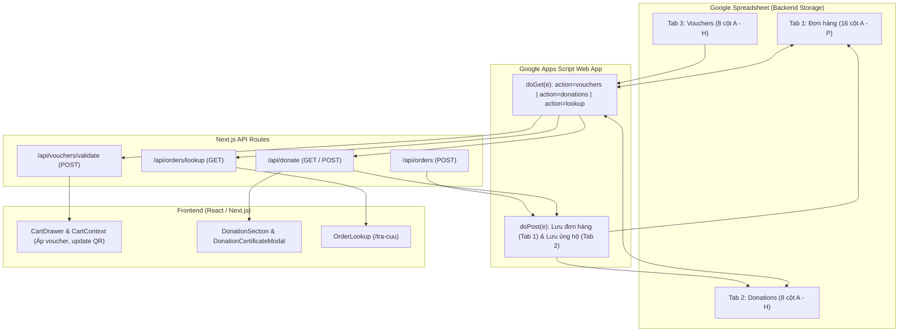

# Thiết Kế Chi Tiết: Tính Năng Donation & Áp Mã Giảm Giá (Vouchers)

- **Chiến dịch**: Hành Trình Dòng Nước Về Nguồn — The Boys FPT
- **Ngày lập**: 14/10/2026
- **Trạng thái**: Đã phê duyệt (Approved)

---

## 1. Mục tiêu & Bối cảnh

Chiến dịch **"Hành Trình Dòng Nước Về Nguồn"** gây quỹ trao 20 phần quà dinh dưỡng (150.000đ/phần, mục tiêu 3.000.000đ) tri ân các cô chú thương binh vào ngày 17/10/2026.

Dự án cần hoàn thiện 2 tính năng trọng tâm:
1. **Hệ thống Mã Giảm Giá (Vouchers)**:
   - Cho phép ban tổ chức quản lý danh sách mã giảm giá trực tiếp trên Google Sheet (tab `Vouchers`) mà không cần sửa code web.
   - Hỗ trợ giảm theo %, đơn tối thiểu (min spend), hạn dùng (expiry date), và giới hạn ngành hàng áp dụng (`all`, `combo`, `flower`, `snack`, `drink`).
   - Khách nhập mã trong giỏ hàng (`CartDrawer`), hệ thống xác thực trực tiếp qua API, tự động cập nhật số tiền thanh toán và mã QR VietQR.
   - Ghi nhận số tiền giảm và mã voucher vào Google Sheet khi đặt hàng.

2. **Hoàn thiện Tính năng Quyên Góp (Donation)**:
   - **Tách riêng Tab `Donations` độc lập (8 cột A-H)**: Không còn lưu chung vào bảng Đơn hàng. Tự động khởi tạo tab trên Sheet nếu chưa có.
   - Kết nối dữ liệu sao kê thời gian thực từ Google Sheet, cập nhật số phần quà đã đạt được.
   - Xuất hiện Modal **"Chứng Nhận Tấm Lòng Vàng"** (Giấy chứng nhận tri ân điện tử) ngay sau khi xác nhận chuyển khoản, cho phép tải ảnh độ nét cao để chia sẻ mạng xã hội.
   - Tích hợp tra cứu mã ủng hộ `DNxxxx` và số điện thoại trên trang `/tra-cuu` với giao diện thẻ tri ân riêng biệt (tra cứu đa tab thông minh).

---

## 2. Kiến trúc & Luồng Dữ Liệu

---

## 3. Đặc Tả Chi Tiết

### 3.1. Phân hệ Mã Giảm Giá (Vouchers)

#### Cấu trúc Tab `Vouchers` trên Google Sheet:
- **Cột A**: `Mã giảm giá` (Code, VD: `THEBOYS10`, `K20FPT`, `HOA20`)
- **Cột B**: `Phần trăm giảm (%)` (DiscountPercent, VD: `10`, `15`)
- **Cột C**: `Giảm tối đa (đ)` (MaxDiscount, VD: `20000`, 0 hoặc để trống là không giới hạn)
- **Cột D**: `Đơn tối thiểu (đ)` (MinSpend, VD: `60000`)
- **Cột E**: `Ngành hàng áp dụng` (ApplicableCategory: `all`, `combo`, `flower`, `snack`, `drink`)
- **Cột F**: `Hạn sử dụng` (ExpiryDate: định dạng YYYY-MM-DD hoặc DD/MM/YYYY)
- **Cột G**: `Kích hoạt` (Active: TRUE/FALSE)
- **Cột H**: `Mô tả` (Description: VD "Giảm 10% tối đa 20k cho combo từ 60k")

#### Quy tắc tính giảm giá:
- Kiểm tra tính hợp lệ:
  1. Mã tồn tại và `Active === true`.
  2. Chưa quá `ExpiryDate` (theo múi giờ GMT+7).
  3. `subtotal >= MinSpend`.
  4. Nếu `ApplicableCategory !== "all"`, kiểm tra trong giỏ hàng có sản phẩm nào thuộc ngành hàng đó không.
- Số tiền giảm:
  - Nếu `all`: `discount = subtotal * (percent / 100)`.
  - Nếu theo ngành hàng: `discount = eligibleCategorySubtotal * (percent / 100)`.
  - Giới hạn: `if (maxDiscount > 0) discount = Math.min(discount, maxDiscount)`.
  - `total = Math.max(0, subtotal - discount)`.

---

### 3.2. Phân hệ Quyên Góp (Donation) & Chứng Nhận

#### Cấu trúc Tab riêng biệt `Donations` trên Google Sheet:
- **Cột A**: `Mã ủng hộ` (Mã dạng `DNxxxx`, VD: `DN12345`)
- **Cột B**: `Thời gian` (Ngày giờ gửi ủng hộ)
- **Cột C**: `Tên người ủng hộ` (Họ tên hoặc "Nhà hảo tâm giấu tên")
- **Cột D**: `Số tiền (đ)` (Số tiền đóng góp)
- **Cột E**: `Số điện thoại` (SĐT tùy chọn để tra cứu)
- **Cột F**: `Lời chúc tri ân` (Thông điệp gửi tới các cô chú cựu chiến binh)
- **Cột G**: `Ẩn danh` (`TRUE` / `FALSE`)
- **Cột H**: `Trạng thái` (Trạng thái đối soát: `Đã chuyển khoản (VietQR)` / `Đã vào quỹ tri ân`)

> ⚡ **Tự động tạo tab**: Google Apps Script tự động chèn tab `Donations` và format 8 cột màu vàng/xanh nếu tab chưa tồn tại trong bảng tính.

#### Modal Chứng Nhận Tri Ân:
- Hiển thị ngay sau khi người dùng xác nhận chuyển khoản ủng hộ.
- Gồm:
  - Khung viền mạ vàng phong cách tri ân The Boys FPT.
  - Tên nhà hảo tâm (hoặc Nhà hảo tâm giấu tên).
  - Số tiền đóng góp (định dạng VND).
  - Lời chúc tri ân.
  - Mã ủng hộ `DNxxxx` và mã QR dẫn link tra cứu.
  - Chức năng **"Lưu ảnh chứng nhận"**: Render trực tiếp lên HTML5 Canvas với tỷ lệ 16:9 / thẻ vuông độ phân giải cao và tự động tải file `.png`.

#### Nâng cấp Tra cứu Đa Tab Thông Minh:
- Nhập mã `DNxxxx`: Tra cứu trực tiếp trên tab `Donations`.
- Nhập mã `DHxxxx`: Tra cứu trên tab `Đơn hàng`.
- Nhập Số điện thoại: Quét và hợp nhất kết quả từ cả 2 tab để khách theo dõi toàn diện.
- Giao diện thẻ hiển thị nổi bật với biểu tượng Trái Tim, số phần quà tương ứng đóng góp, trạng thái đối soát rõ ràng và nút tải lại chứng nhận.

---

## 4. Danh Sách File Triển Khai

| STT | Đường dẫn file | Trạng thái | Nhiệm vụ |
|---|---|---|---|
| 1 | `scripts/google-apps-script.js` | Cập nhật | Bổ sung action `vouchers` đọc tab `Vouchers`; hoàn thiện filter trả về `DNxxxx` |
| 2 | `src/types/index.ts` | Cập nhật | Bổ sung interface `Voucher`, `VoucherValidationResult` |
| 3 | `src/app/api/vouchers/validate/route.ts` | Tạo mới | API xác thực mã giảm giá với Google Sheet & Fallback |
| 4 | `src/context/CartContext.tsx` | Cập nhật | Quản lý state voucher, tính `discountAmount`, cập nhật `total` |
| 5 | `src/components/CartDrawer.tsx` | Cập nhật | Input mã giảm giá, hiển thị badge giảm giá, cập nhật QR VietQR |
| 6 | `src/components/DonationCertificateModal.tsx` | Tạo mới | Modal chứng nhận tri ân có tính năng tải ảnh PNG |
| 7 | `src/components/DonationSection.tsx` | Cập nhật | Tích hợp mở Certificate Modal sau khi submit ủng hộ |
| 8 | `src/components/OrderLookup.tsx` | Cập nhật | Phân biệt hiển thị đơn hàng `DH` và đơn ủng hộ `DN` |
